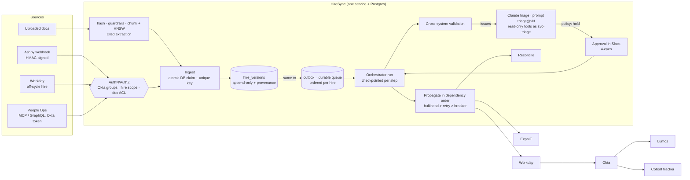

# HireSync: onboarding change propagation with cross-system validation

A working prototype for the BetterUp onboarding problem. A change to a new hire
(from Ashby, an off-cycle Workday hire, an uploaded document or a human
correction) becomes a new **version** of one canonical record. It is **validated
across systems**, **triaged by Claude** when something looks wrong, held for a
**human** when it must be, and **propagated** to Workday, Okta, Lumos, ExpoIT
and the cohort tracker. Every reader and writer is **authenticated and
authorized** (Okta groups, per-hire scope, document classification), and every
model decision is tied to a **versioned prompt**.

It is built on the existing stack only. The default runtime is one service plus
its database (an async worker pool consuming the outbox), no Kafka, no Redis, no
new vendor. Every wait has a timeout, every failure path ends in a dead-letter
queue a human can redrive, every model call is under a token and cost budget and
an evaluator that can send the answer back, and n8n/Zapier hear about events
through signed webhooks.

```bash
uv venv && uv pip install -e ".[dev]"
python demo.py                    # 14 scenarios, offline, ~5 s
pytest -q                         # 81 tests
OTEL_EXPORTER_OTLP_ENDPOINT=https://<backend> python demo.py   # export traces + metrics (pip install ".[otlp]")
uvicorn hiresync.api:api          # GraphQL at /graphql (Bearer token required)
MCP_TOKEN=<jwt> python -m hiresync.mcp_server        # MCP over stdio
python -m hiresync.prompt_registry list | diff triage v1 v2 | lock
AGENT_MODE=claude ANTHROPIC_API_KEY=... python demo.py      # real Claude triage
ANTHROPIC_API_KEY=... python -m hiresync.behave --versions v1 v2 --repeats 3
```

---

## 1. Systems map



| Break today | Example | Handled by |
|---|---|---|
| Changes don't propagate | Start date moves; tracker and laptop ship date stay old | Versioned record; one run per version writes **only the systems whose projection changed** |
| Bad data cascades | Typo in Ashby becomes the Okta login and the shipping label | Validation runs **before** any write; BLOCK issues stop the run |
| Duplicates | Webhook retried; same offer letter uploaded by 3 people | Atomic DB claim, unique constraints, downstream Idempotency-Key |
| Partial failure | Okta down: Workday updated, Lumos has no user | Retry + circuit breaker, dependency-aware blocking, DLQ, `retryRun` |
| Nobody knows who changed what | "Why does Workday say Denver?" | Field provenance (source, actor, document, citation) + hash-chained audit |
| Everyone sees everything | Hiring manager opens an offer letter with compensation | Okta groups → permissions, per-hire scope, document classification, PII masking |

## 2. Why this slice

**Change propagation**, with validation built in:

- **It's the root cause.** Bad data cascades *because* propagation is a blind copy, so validation
  belongs inside propagation as its gate.
- **Exception monitoring falls out of it.** Each run is a durable record with status, issues,
  results and approvals, so a stuck run or a pending approval is something you can query. The
  7-day deadline monitor becomes a scheduled query over the same tables.
- It's where the engineering risk is: ordering, partial failure, idempotency.

## 3. Using the existing stack

This was a design decision, so here is what was chosen and what was rejected:

| Need | Chosen (existing stack) | Rejected, and why |
|---|---|---|
| Event delivery, ordered per hire | **Outbox table as the queue** (`DbQueueBus`): rows are processed in id order per hire and marked processed only after the handler succeeds. Postgres: `FOR UPDATE SKIP LOCKED` + a per-hire advisory lock for multiple workers. | **Kafka**: at hundreds of hires a month it would be a cluster to run for no gain. The adapter is still there (`BUS=kafka`) for the day another team needs the stream. |
| Idempotency / run locks | **DB**: `INSERT … ON CONFLICT DO NOTHING` claims with leases (`idempotency_keys`), plus unique constraints on the business tables | **Redis**: a cache in front of a guarantee the DB already gives. Optional (`REDIS_URL`); a test proves the same contract. |
| Identity, groups | **Okta** (JWT `groups` claim) | none needed |
| Approvals | **Slack** (Block Kit buttons → `decideApproval`) | a custom approval UI |
| Triggers | **n8n / Zapier** forward the Ashby webhook to `/webhooks/ashby` | orchestration *in* n8n: idempotency, checkpoints and the dependency graph need testable code |
| AI | **Claude** (triage, extraction, MCP for People Ops) | none |
| Vector search | **In-process HNSW** (`usearch` library) over vectors stored in the DB; production: **pgvector HNSW** in the same Postgres | a separate vector database |
| Embeddings | Local feature-hashing embedder (no vendor) | a new embedding vendor; the `embed_model` column lets one be swapped in later with a re-embed |

GraphQL, PyJWT and usearch are libraries inside the service, not systems to operate.

## 4. Key design decisions

**Append-only versions.** Every change is a new row with a content hash. A diff between any two versions
is a pure function, identical content is a no-op, and an optimistic lock (`expected_version`) prevents
lost updates.

**Each system's target is what it last accepted.** `_targets` compares each system's projection of the new
record with the payload that system last accepted, not with the previous version. A superseded or partial
run never leaves a field behind. A manager change writes Workday, Okta and the tracker, and nothing else.

**Transactional outbox = queue.** The version, its field provenance and its event commit in one
transaction. A test kills the process after the commit and before any handling; the event is delivered
on restart.

**Idempotency, three layers.**

| Layer | Key | Protects against |
|---|---|---|
| DB claim with lease | `event:<id>`, `doc:<sha256>`, `runlock:<run>` | concurrent duplicates; a crashed owner's claim is taken over |
| Unique constraints | `inbound_events.event_id`, `documents.doc_hash`, `(doc_hash, uploader, filename)` | the guarantee: holds even when the claims table is wiped (tested) |
| Downstream Idempotency-Key | `<hire>:v<n>:<system>` | a write that landed but wasn't recorded before a crash |

**Document hashing.** Identity is SHA-256 of the *normalised* text (BOM, CRLF, NFC, trailing whitespace).
Four uploads by three people produce 1 document, 1 extraction and 1 version, plus 3 upload rows. A
document can create at most one version (`event_id = doc:<hash>`), and the same bytes can't be filed
under a second hire.

**Checkpoints and human approval.** The run's working memory is saved after every step. A run waiting for
approval is a row, not a sleeping process (the demo kills the worker mid-approval). Approving with a patch
creates a new version. A newer version supersedes older pending approvals. **Separation of duties:**
nobody can approve their own change.

**Resilience.** Bulkhead semaphore per attempt → retry (exponential backoff with full jitter, transient
errors only) → circuit breaker (opens after 3 failures, then a single half-open probe). A 400 never trips
the breaker; an open breaker defers the write instead of failing it; dependents of a failed system are
marked `blocked` without being called.

### Authentication and authorization

| Layer | Rule |
|---|---|
| AuthN | Okta-shaped JWT (`sub`, `email`, `groups`), with `iss`, `aud` and `exp` verified. Prototype: HS256 dev issuer; production: RS256 against Okta's JWKS (only `auth._decode` changes). Users can't claim `svc-*` groups. GraphQL returns 401 without a token; MCP fails closed without `MCP_TOKEN`; the Ashby webhook is HMAC-verified. |
| RBAC | `people-ops`: everything incl. approvals · `recruiting`: read, write, upload, search · `it`: read incl. addresses, search · `hiring-manager`: read · `auditor`: read + audit · `svc-triage`: read-only for the agent |
| ABAC (hire) | hiring manager → only hires where `manager_email` is theirs · triage agent → only the hire it is triaging. A denied hire and a missing hire return the same error, so access can't be used to probe which hires exist. |
| Document ACL | classification from type: `offer_letter`=confidential (people-ops, recruiting) · `it_hardware_form`=internal (+ it) · `address_change`=restricted (people-ops). Uploaders can read their own uploads. Duplicate uploads are judged on group membership only, so uploading a copy can't unlock the original's details. |
| Filtering on metadata | Vector search runs the *same* ACL predicate plus hire and doc-type filters during retrieval (§ Retrieval), so search can't return what a direct read would deny. Provenance hides citations to documents the caller can't read. |
| Masking | `personal_email` and `shipping_address` are `[MASKED]` without `hire:read_pii`, everywhere: tools, GraphQL versions, diffs, provenance. |
| Per-caller tools | MCP `list_tools` and GraphQL `tools` show only what the caller may use; calling an unlisted tool is still refused. Every denial is audited. |

### Prompt versioning and behavioural testing

- **Versions are files**, e.g. `hiresync/prompts/triage/v2.md`, with front matter holding the model and effort setting. A version is text + model + effort, since all three change behaviour, and `sha256` covers all three.
- **Immutable versions.** `prompts.lock.json` pins every version's hash; a test fails if a version is edited in place, and `lock` refuses to re-pin one.
- **Active version** comes from `active.json`, overridable per process with `PROMPT_TRIAGE_VERSION=v2` (A/B or shadow runs).
- **Every model call is recorded** in `llm_calls`: prompt@version, its hash, model, effort, a hash of the tool list, input, output, number of retries, tool calls, token usage, latency, run id and trace id. Each recommendation also carries the version that produced it (`rec.prompt`).
- **Behavioural tests** (`evals/triage_cases.jsonl`, `python -m hiresync.behave`):
  - Cases state *behaviour* rather than exact text: allowed actions, actions that must never happen, the policy outcome, evidence that must be cited, expected fixes, and a tool budget.
  - Each case runs N times per version and reports its pass rate. A case that passes only some of the time is flagged as flaky.
  - The report lists which cases improved or regressed between versions, and carries each prompt's hash.
  - Cases can seed state (hire versions, the Okta account) so the agent's tools see a real situation.
- **Replay** (`--replay db --candidate v2`) re-runs recorded production inputs against a candidate version and measures agreement with the decisions humans actually made (from episodic memory).
- `triage@v2` is a candidate that holds identity changes once an Okta account exists. The harness test shows it fixing the `staged_login_change_held_despite_precedent` case that v1 fails.

### Async workers, dead-letter queue, timeouts

**Worker pool** (`events.DbQueueBus`, `WORKERS=4`):
- N async workers compete for events. A claim is an atomic lease on the **head** event of one hire's queue, so per-hire order is kept with any number of workers while different hires run in parallel (tested: 4 workers, 4 hires × 5 events, order intact, peak concurrency ≥ 3).
- A lease that expires (crashed worker) is taken over; an ack is fenced by lease owner.
- Failures back off exponentially with jitter. Shutdown is graceful.
- On Postgres, the claim becomes `FOR UPDATE SKIP LOCKED` for multiple processes.

**Dead-letter queue**, one view over two kinds:
- `event`: an event that exhausted its deliveries. A permanent error such as a 400 is dead-lettered immediately. A dead event stops blocking its hire.
- `write`: a downstream write that failed or timed out.

Each entry can be listed (`list_dead_letters`: people-ops, auditor), redriven or discarded with a required note (`redrive_dead_letter` / `discard_dead_letter`: people-ops only). Every action is audited, and each new dead letter alerts Slack and emits a `dlq.dead` webhook.

**Timeouts** (`resilience.Timeouts`, validated at construction):

| Wait | Bound | On expiry |
|---|---|---|
| Downstream call | per system (`call`, default 10 s) | `CallTimeout` (retryable, counts toward the breaker) |
| One write's retries | `retry_budget` 60 s | stop retrying → dead-letter the write |
| Event handler | `handler` 120 s | nack → backoff → DLQ |
| Worker lease | `lease` 300 s (> handler, enforced) | another worker takes over |
| Claude tool loop | `claude` 90 s | deterministic heuristic |
| Approval | `approval_sla` 4 h | sweeper escalates to Slack once |
| Stuck run | `stuck_run` 10 min | sweeper re-drives from checkpoint |
| Webhook POST | 5 s | retry → DLQ |

A timeout *after* a write landed is safe: the retry carries the same idempotency key, so the system replays its stored response (tested: workday `writes == 1`, `attempts == 2`).

### Token and cost guardrails

`budget.CostGuard` runs before **every turn** of the tool loop, since history is resent each turn:
- per-call input cap (estimated tokens; refused before any API call)
- `max_tokens` clamped
- per-run token and USD caps, read from the `llm_calls` ledger
- a daily USD cap: when hit, Slack is alerted once, a `budget.daily_exceeded` webhook goes out, and the agent falls back to the heuristic
- at most N model calls in flight

Real usage from each response is priced (Opus 5.5: $4 / $20 per million tokens) and stored per call. An unknown model refuses to run rather than spend without a price. `get_model_spend` shows today's spend against the caps.

### Evaluator → retry

After a schema-valid answer, `evaluator.py` checks it against the run:
- never proceed over a BLOCK issue
- every BLOCK issue is cited
- proceed needs confidence ≥ 0.8
- the approver message names the hire; the rationale references the issues
- a proposed patch is re-run through the same validation rules: it must resolve the issue it targets and introduce no new blocking issue

Problems go back to Claude as a critique for one retry. If the evaluator still disagrees, the answer is kept for the approver but marked `evaluation.passed=false`, and `apply_policy` forces a human hold. An optional second-opinion reviewer (`EVALUATOR_LLM=1`) uses `claude-haiku-5-5` with the versioned prompt `judge@v1`, under the same cost guard.

### Webhooks

- **Inbound** (Ashby): HMAC over `"<timestamp>.<body>"`, timestamp within 5 minutes (replay protection), plus Idempotency-Key dedupe.
- **Outbound:** subscriptions per event type (`run.completed`, `run.partial`, `approval.requested`, `approval.decided`, `dlq.dead`, `budget.daily_exceeded`).
  - Delivery goes through the worker pool, ordered per subscriber, so it gets backoff and the DLQ for free.
  - Requests are signed `t=…,v1=hmac` with an event id for receiver dedupe. The secret is shown once.
  - Allowed hosts are https only, on an allowlist (n8n, Zapier, Slack), with no IP literals or internal hosts and no redirects.
  - A dead webhook delivery never emits a webhook, so a broken subscriber can't loop.

### OpenTelemetry: error analysis, latency, tokens, cost

`telemetry.py` registers a tracer and meter provider at startup, **before** any Claude client exists. Export goes over OTLP/HTTP when `OTEL_EXPORTER_OTLP_ENDPOINT` is set (any backend: Datadog, Honeycomb, Grafana, Langfuse…; `docker compose up jaeger` for a local viewer). Otherwise spans and metrics are kept in memory for the demo, the tests and `errorAnalysis`.

**One trace per change.** The trace context travels inside the outbox row, so the worker's CONSUMER span *links* to the request that caused it (a link, not a parent, because an event can run minutes later or several times). The span tree for one change is:
- `hiresync.ingest` (SERVER)
- `hiresync.event hire.changed` (CONSUMER, linked to the ingest span), containing:
  - `hiresync.run.validate`, `hiresync.run.triage`, `hiresync.run.propagate`, `hiresync.run.reconcile`
  - `hiresync.system.write <system>` (CLIENT): one per attempt, with outcome `ok | timeout | transient | permanent | breaker_open`, `error.type`, breaker state and timeout
  - `hiresync.llm triage`, which contains `anthropic.messages.create` (the **Anthropic SDK's own span**, with `gen_ai.usage.*`) and `hiresync.tool <name>` spans
- `hiresync.event webhook.deliver`, which sends `traceparent` on, so an instrumented n8n joins the trace

The pipeline's `trace_id` **is** the OpenTelemetry trace id, so the id shown in a run, an audit row or a Slack message is what you search for in the backend. A log filter (`TraceContextLogFilter`) adds `trace_id` and `span_id` to log lines.

**Tokens and cost, counted once.**
- The SDK span carries `gen_ai.usage.*` per request.
- Our `hiresync.llm` span covers a whole tool loop, including retries after validation errors and evaluator retries, under *different* names (`hiresync.llm.input_tokens`, `…output_tokens`, `…cost_usd`, `…reasks`, `…eval_retries`, `hiresync.prompt`). Backends that sum `gen_ai.usage.*` therefore count each token exactly once.
- The SDK runs in its default **metadata-only** mode: no prompts or responses leave the process, because they contain hire data.
- A test drives the **real** SDK over a mocked `httpx2` transport to prove the nesting, the usage attributes and that `traceparent` goes to the API.

**Metrics:**

| Metric | Broken down by |
|---|---|
| `hiresync.llm.tokens` | model, purpose, prompt, direction |
| `hiresync.llm.cost` (USD) | model, purpose, prompt |
| `hiresync.llm.calls` | outcome, error.type |
| `hiresync.llm.duration` | — |
| `hiresync.system.calls` | system, outcome, error.type |
| `hiresync.system.duration` | system, outcome |
| `hiresync.events.processed` | topic, outcome |
| `hiresync.event.duration` | — |
| `hiresync.dlq.dead` | kind, topic |
| `hiresync.runs.finished` | status, decision |
| `hiresync.authz.denied` | tool |
| `hiresync.budget.blocked` | code |

**Error analysis** (`telemetry.error_report()`, GraphQL `errorAnalysis`, demo section 14) reports:
- errors grouped by span / system / `error.type`, with an example message
- per-system attempts, p50/p95 latency and outcome mix
- tokens, cost, retries and evaluator retries per `purpose:prompt@version`
- usage from the SDK spans

Expected outcomes (an authorization denial, a budget block, an open breaker, an evaluator hold) record `error.type` but leave the span status unset, so they're analysable without paging anyone. Real failures set status ERROR.

**Not set up:** Claude API tracing, i.e. server-side spans delivered to a destination you configure. It adds per-model-request spans inside each API call and appears in the same trace, because the SDK already sends `traceparent`. It needs an org admin to add an OTLP destination, plus a decision on which backend and content mode to use.

### Acyclic dependency graph

Propagation order comes from the system dependency graph: workday → okta → {lumos, tracker}, with expoit independent. `validate_dag` rejects unknown dependencies and cycles at startup, naming the cycle (e.g. `lumos -> okta -> workday -> lumos`). Kahn's algorithm then produces the parallel levels. The run itself is a forward-only state machine (`START → … → DONE`); the only way back is an explicit resume from a checkpoint.

### Retrieval: adaptive chunking and HNSW

- **Adaptive chunking** (`chunking.py`) follows the document's structure. It splits lines into headings, form fields, list items, table rows and prose, groups them into sections under their headings, and picks a strategy per section:

  | Section | Target / max chars | Rule |
  |---|---|---|
  | Form fields | 450 / 700 | a field is never split from its value |
  | List | 650 / 900 | cut only between items |
  | Table | 800 / 1100 | cut only between rows |
  | Prose | 700 / 1000 | cut where neighbouring sentences are least similar (topic shift) |

  - Paragraph breaks always beat cuts inside a paragraph.
  - Chunks overlap only when a cut was forced through related text.
  - Tiny sections merge; a document of 700 characters or less stays one chunk.
  - Each chunk keeps its kind and section heading. The heading is included in the embedding for context; the chunk text stays an exact slice of the document, so every hit is a citation.
  - Chunk ids are `<doc_hash>:<idx>`, so a duplicate document is never re-indexed.
- **HNSW** (`vectors.py`, usearch: M=16, ef_construction=128, ef_search=64) indexes two things: document chunks, and episodes for semantic recall. The index is derived from vectors stored in the DB and rebuilt on start (tested).
- **Filtered search:** the filter runs during retrieval, widening the candidate set (k, 4k, 16k…). Because HNSW is approximate and can miss nodes even when asked for everything, it falls back to an exact scan of the items that pass the filter. Production: pgvector HNSW with the ACL as a SQL `WHERE` clause and iterative index scans.
- **Long documents** (over 6,000 characters): extraction sends only the chunks relevant to the fields it needs, with their offsets. Quotes are still checked against the full text.
- **Episodic recall** is a blend: HNSW finds candidates, scored 0.7 × feature overlap + 0.3 × cosine similarity.

### Claude as a component

- Claude is called only when validation finds issues.
- It uses read-only tools as `svc-triage`, scoped to the one hire it is triaging.
- It returns a structured `Recommendation` with evidence references, validated Instructor-style: the Pydantic schema plus semantic checks. Evidence must exist in this run, a patch may touch only editable fields, the Slack message must contain no PII, and every extracted quote must appear verbatim in the document. Failures are sent back for another attempt.
- **Code has the final word** (`apply_policy`). If Claude fails, a deterministic heuristic with the same contract takes over.
- The `instructor` package isn't used: its default mode forces `tool_choice`, which Opus 5.5 rejects, and its `JSON_SCHEMA` mode sends a deprecated parameter and strips the tools.

**Guardrails.**
- Uploads: size limit, MIME allowlist, UTF-8 only.
- Injection scan: a flagged document produces a BLOCK issue.
- PII (SSN, card and bank numbers, dates of birth) is redacted before storage, before indexing and before any model call.
- Documents reach the model wrapped in `<untrusted_document>` tags.
- Tools: allowlist, input validation, a budget of 8 calls per run, redacted results.
- MCP is read-only unless `MCP_ALLOW_WRITES=1`, and tools carry read-only/write annotations.

## 5. What I'd productionize

- Postgres + pgvector instead of SQLite + in-process usearch (same schema; the ACL becomes a SQL filter); `SKIP LOCKED` workers.
- Okta JWKS (RS256) verification; MCP auth via OAuth 2.1 with Okta as the authorization server; Ashby HMAC secret from a vault.
- Real adapters (Workday, Okta Users API with rate-limit headers driving `retry_after`, Lumos, ExpoIT, Google Sheets).
- Deadline monitor as a scheduled query → Slack.
- Grow `evals/triage_cases.jsonl` from real resolved exceptions; run `behave` in CI on any prompt change; promote a candidate version only on non-regression; weekly replay against human decisions.
- PDF ingestion (text layer, OCR fallback); a semantic embedder if one is approved, with a re-embed when the model changes.
- OpenTelemetry spans keyed by `trace_id`; alerts on dead events, open breakers, approval age.

## 6. AI tools used, and what the AI got wrong

Built with Claude Code. Each mistake below was caught by running the code, not by reading it:

1. **Over-propagation.** Every write to an upstream system re-wrote all its dependents, so a manager change re-wrote Lumos. Caught in the demo's `targets` output.
2. **Missing dependency edge.** The tracker shows the Okta login but didn't declare that dependency. Caught when an address-only change targeted the tracker.
3. **Defaults not applied.** Records were stored without default values filled in, so a projection raised `KeyError`. Caught by the MCP stdio smoke test.
4. **Library assumption.** `instructor`'s default mode forces `tool_choice`, which Opus 5.5 rejects. Caught by reading the library's source; replaced with the same pattern.
5. **HNSW recall assumption.** The filtered search assumed that widening k to the index size returns everything; usearch returned 245 of 300, missing an allowed item. Caught by a test; fixed with an exact fallback over the filtered subset.
6. **Access-control hole I introduced.** Duplicate uploads added the uploader *before* the read check, so "uploaders can read" let anyone with upload rights unlock a confidential document by uploading a copy. Caught while writing the code; the check now uses group membership only, and a test covers it.
7. **Import side effect.** `api.py` opened the database on import, and a stale file with an old schema broke test collection. The API now builds its app at startup.
8. **A race that only parallel workers exposed.** Same-name hires processed concurrently all passed validation, because none could see the others' in-flight Okta writes, and then failed at Okta with 409s. Caught by the throughput test. Fixed with an atomic login reservation in the DB during validation; a regression test checks that exactly one wins.
9. **Access metadata lost on index rebuild.** Chunks rebuilt after a restart lost their document type and classification, so filtered search denied everything (fail-closed, but wrong). Caught while wiring chunk headings; a regression test searches after a restart.
10. **Chunker kept over-target sections whole** whenever the remainder fit under the hard cap, and **negative cosine similarity outranked paragraph breaks** (signed hashing). Both caught by the adaptive-chunking test; natural breaks now score −1 and cosine is clipped to [0, 1].
11. **Evaluator too lenient.** It only rejected patches that introduced *new* blocking issues, so a patch that didn't fix the original one passed. Caught in the demo output; it now re-validates and requires the targeted issue to be resolved.
12. **Trace context leaked into handlers.** The `_otel` carrier added to queue payloads was passed through to event handlers. Caught by the worker test; the worker now strips transport metadata before dispatch.
13. **A flaky test of mine.** The retry-budget test counted attempts, but with full jitter the count is random; the budget bounds *time*. The test now asserts elapsed time.

**Not verified here:** no Anthropic credentials were available. The Claude path (tool loop, re-ask, prompt recording) and the behavioural harness are exercised with scripted clients, not real calls. Run `AGENT_MODE=claude … demo.py` and `python -m hiresync.behave` to exercise them for real.

## Layout

```
hiresync/
  models.py          canonical HireRecord, canonicalize()
  versioning.py      hashing, flatten, field-level diff
  store.py           schema + transactions (versions, outbox-queue, runs, side effects, approvals, documents,
                     provenance, episodes, idempotency keys, chunks/vectors, llm_calls, hash-chained audit)
  auth.py            JWT authN, groups→permissions, hire ABAC, document ACL, search filter, masking
  idempotency.py     DB claims (default) / Redis (optional), same interface
  events.py          DbQueueBus worker pool (default) / InMemoryBus / KafkaBus + outbox relay
  budget.py          token/cost guardrails, price table, spend ledger checks
  evaluator.py       evaluator-optimizer checks (+ optional judge@vN)
  webhooks.py        inbound verification, outbound signed delivery, URL allowlist
  telemetry.py       OpenTelemetry setup, spans/metrics helpers, queue context propagation, error_report()
  resilience.py      retry + jitter + budget, circuit breaker, bulkheads, timeouts
  connectors.py      mocked Workday/Okta/Lumos/ExpoIT/tracker + projections
  validation.py      cross-system rules
  memory.py          working memory (checkpoint) + episodic memory (hybrid HNSW recall)
  chunking.py        adaptive, offset-preserving chunker
  vectors.py         hashing embedder, HNSW index with filtered search + exact fallback
  guardrails.py      upload limits, injection scan, PII redaction, tool budget
  prompt_registry.py versioned, locked prompts; CLI list/diff/lock
  prompts/           triage/v1–v2, extraction/v1, judge/v1, active.json, prompts.lock.json
  structured.py      Instructor-style calls: tool loop, re-ask, per-call recording
  agent.py           Claude triage as svc-triage, heuristic fallback, apply_policy
  behave.py          behavioural test runner: version comparison, flakiness, replay
  documents.py       hashing, ACL-aware dedupe, chunk+index, cited extraction
  orchestrator.py    checkpointed run state machine, approvals (4-eyes), retry, recovery
  tools.py           tool registry with permissions (shared by agent, MCP, GraphQL)
  mcp_server.py, graphql_schema.py, api.py, app.py
evals/triage_cases.jsonl, demo.py, tests/, scripts/mcp_smoke.py
```
